# Petproject Microservices Platform: Distributed E-Commerce Architecture

[-ED8B00?logo=openjdk&logoColor=white)](https://openjdk.org/projects/jdk/25/)
[](https://spring.io/projects/spring-boot)
[](https://spring.io/projects/spring-cloud-gateway)
[-231F20?logo=apachekafka&logoColor=white)](https://kafka.apache.org/)
[](https://www.postgresql.org/)
[](https://redis.io/)
[](https://www.elastic.co/)
[](https://www.keycloak.org/)
[-blue)](https://rustfs.com/)
[](LICENSE)

> **Project overview**:
> Petproject Microservices Platform is a cloud-native distributed e-commerce backend built on Java 25 (LTS) and Spring Boot 4.1.1. The repository is organized as a Maven multi-module reactor with 23 modules, comprising 14 backend microservices, 8 shared platform libraries, and a parent aggregator.
>
> The system implements domain-driven design, isolated PostgreSQL databases per service, choreography sagas with two-phase inventory reservation, transactional outbox publishing over Apache Kafka (KRaft mode), two-layer token-bucket rate limiting in Redis at the edge gateway, full-text search with Elasticsearch BM25, and OAuth2/OIDC identity management backed by Keycloak 26.

---

## Table of contents

- [1. System landscape architecture](#1-system-landscape-architecture)
- [2. Microservices catalog](#2-microservices-catalog)
- [3. Business and functional flows](#3-business-and-functional-flows)
  - [Flow 1: Authentication and edge routing](#flow-1-authentication-and-edge-routing)
  - [Flow 2: Product catalog and search synchronization](#flow-2-product-catalog-and-search-synchronization)
  - [Flow 3: Media processing pipeline](#flow-3-media-processing-pipeline)
  - [Flow 4: Wishlist, shopping cart, and pricing](#flow-4-wishlist-shopping-cart-and-pricing)
  - [Flow 5: Checkout and two-phase inventory reservation](#flow-5-checkout-and-two-phase-inventory-reservation)
  - [Flow 6: Stripe payments and order confirmation](#flow-6-stripe-payments-and-order-confirmation)
  - [Flow 7: Shipment fulfillment and delivery updates](#flow-7-shipment-fulfillment-and-delivery-updates)
  - [Flow 8: Verified buyer ratings and reviews](#flow-8-verified-buyer-ratings-and-reviews)
  - [Flow 9: Expired stock sweepers and compensations](#flow-9-expired-stock-sweepers-and-compensations)
- [4. Event-driven messaging backbone](#4-event-driven-messaging-backbone)
- [5. Edge security and rate limiting](#5-edge-security-and-rate-limiting)
- [6. Shared platform libraries (`utils/`)](#6-shared-platform-libraries-utils)
- [7. Local development guide](#7-local-development-guide)
  - [Prerequisites](#prerequisites)
  - [Step 1: Start infrastructure containers](#step-1-start-infrastructure-containers)
  - [Step 2: Toolchain setup and compilation](#step-2-toolchain-setup-and-compilation)
  - [Step 3: Launch microservices](#step-3-launch-microservices)
- [8. Testing and observability](#8-testing-and-observability)
- [9. Technical architecture blueprints](#9-technical-architecture-blueprints)

---

## 1. System landscape architecture

The platform follows a layered domain-driven architecture. All external traffic from web clients, mobile apps, admin dashboards, and partner webhooks enters through `gateway-service` on port 8080. The gateway decodes JWT tokens, checks client and system rate limits in Redis, stamps distributed correlation IDs, and forwards requests to internal microservices over Docker network DNS.

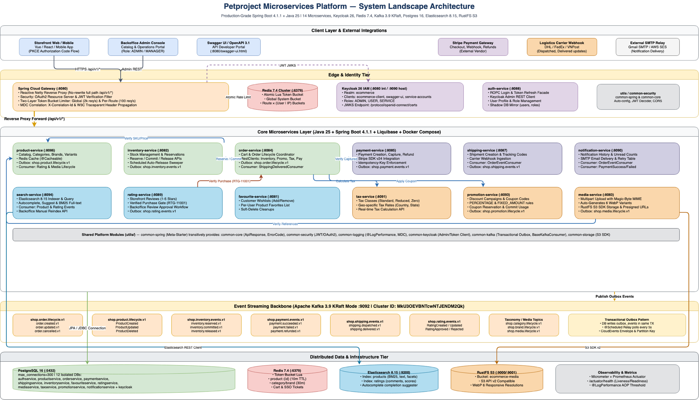

> [!TIP]
> **Architecture diagrams directory**:
>
> | Index | Diagram | Image preview | Source files |
> |:---:|---|---|---|
> | 1 | **System Landscape Architecture** | [system-landscape-architecture.png](./docs/images/system-landscape-architecture.png) | [.drawio.png](./docs/images/system-landscape-architecture.drawio.png) / [.svg](./docs/images/system-landscape-architecture.svg) |
> | 2 | **Data Stores & Database-per-Service Topology** | [data-stores-infrastructure-topology.png](./docs/images/data-stores-infrastructure-topology.png) | [.drawio.png](./docs/images/data-stores-infrastructure-topology.drawio.png) / [.svg](./docs/images/data-stores-infrastructure-topology.svg) |
> | 3 | **E2E Order Fulfillment Saga** | [e2e-order-fulfillment-saga.png](./docs/images/e2e-order-fulfillment-saga.png) | [.drawio.png](./docs/images/e2e-order-fulfillment-saga.drawio.png) / [.svg](./docs/images/e2e-order-fulfillment-saga.svg) |
> | 4 | **Event-Driven Messaging (Kafka KRaft)** | [event-driven-messaging-architecture.png](./docs/images/event-driven-messaging-architecture.png) | [.drawio.png](./docs/images/event-driven-messaging-architecture.drawio.png) / [.svg](./docs/images/event-driven-messaging-architecture.svg) |
> | 5 | **Gateway Security & Dual Rate Limiting** | [gateway-security-rate-limit.png](./docs/images/gateway-security-rate-limit.png) | [.drawio.png](./docs/images/gateway-security-rate-limit.drawio.png) / [.svg](./docs/images/gateway-security-rate-limit.svg) |

```mermaid
flowchart TB
    classDef clientClass fill:#dae8fc,stroke:#6c8ebf,stroke-width:2px,color:#000000;
    classDef gatewayClass fill:#ffe6cc,stroke:#d79b00,stroke-width:2px,color:#000000;
    classDef authClass fill:#e1d5e7,stroke:#9673a6,stroke-width:2px,color:#000000;
    classDef coreServiceClass fill:#d5e8d4,stroke:#82b366,stroke-width:2px,color:#000000;
    classDef cxServiceClass fill:#b1ddf0,stroke:#10739e,stroke-width:2px,color:#000000;
    classDef pricingServiceClass fill:#fad7ac,stroke:#b46504,stroke-width:2px,color:#000000;
    classDef fulfillServiceClass fill:#d0cee2,stroke:#56517e,stroke-width:2px,color:#000000;
    classDef busClass fill:#fff2cc,stroke:#d6b656,stroke-width:2px,color:#000000;
    classDef storeClass fill:#f5f5f5,stroke:#666666,stroke-width:2px,color:#000000;

    subgraph CLIENTS ["Client Layer and External Callers"]
        WEB["Customer Web / Mobile Client"]:::clientClass
        ADMIN["Backoffice Admin UI"]:::clientClass
        EXT_PAY["Stripe Payment Webhooks"]:::clientClass
        EXT_SHIP["Carrier Logistics Webhooks"]:::clientClass
    end

    subgraph EDGE ["Edge Tier"]
        GW["gateway-service :8080<br/>Two-tier Redis rate limiting<br/>OAuth2 JWT validation via JWKS<br/>Traceparent and correlation headers"]:::gatewayClass
    end

    subgraph IAM ["Identity and Access Tier"]
        KEYCLOAK["Keycloak 26 IAM (:8080 int / :9090 host)<br/>Realm: ecommerce"]:::authClass
        AUTH_SVC["auth-service :8088<br/>ROPC login, token refresh, local user mirror"]:::authClass
    end

    subgraph CORE_COMMERCE ["Core Commerce Domain"]
        PRODUCT_SVC["product-service :8086<br/>Catalog, brands, categories, variants"]:::coreServiceClass
        INV_SVC["inventory-service :8082<br/>Two-phase stock reservation and commits"]:::coreServiceClass
        ORDER_SVC["order-service :8084<br/>Cart management and checkout saga"]:::coreServiceClass
    end

    subgraph CUSTOMER_EXP ["Customer Experience Domain"]
        SEARCH_SVC["search-service :8094<br/>Elasticsearch 8.15 BM25 and suggestions"]:::cxServiceClass
        RATING_SVC["rating-service :8089<br/>Reviews and verified buyer validation"]:::cxServiceClass
        FAV_SVC["favourite-service :8081<br/>Customer wishlists and saved items"]:::cxServiceClass
    end

    subgraph PRICING_MEDIA ["Pricing, Tax, and Media Domain"]
        TAX_SVC["tax-service :8091<br/>Tax classes and jurisdiction rates"]:::pricingServiceClass
        PROMO_SVC["promotion-service :8093<br/>Coupons, campaigns, and discounts"]:::pricingServiceClass
        MEDIA_SVC["media-service :8083<br/>MIME validation and WebP variants"]:::pricingServiceClass
    end

    subgraph FULFILLMENT ["Fulfillment and Notification Domain"]
        PAY_SVC["payment-service :8085<br/>Payment capture, refunds, and Stripe SDK"]:::fulfillServiceClass
        SHIP_SVC["shipping-service :8087<br/>Shipment tracking and carrier callbacks"]:::fulfillServiceClass
        NOTIF_SVC["notification-service :8090<br/>Customer alerts and SMTP email delivery"]:::fulfillServiceClass
    end

    subgraph EVENT_BUS ["Event Streaming Backbone"]
        KAFKA["Apache Kafka 3.9 (KRaft mode :9092)<br/>Topics: order, product, category, brand, inventory, payment, shipping, rating, media"]:::busClass
    end

    subgraph STORAGE ["Data Tier (Isolated Databases)"]
        PG[("PostgreSQL 16 (:5432)<br/>12 isolated service DBs + Keycloak DB")]:::storeClass
        REDIS[("Redis 7.4 (:6379)<br/>Token bucket rate limits and catalog cache")]:::storeClass
        ES[("Elasticsearch 8.15 (:9200)<br/>Product search index")]:::storeClass
        RUSTFS[("RustFS S3 (:9000/:9001)<br/>Media object store")]:::storeClass
    end

    %% Edge wiring
    CLIENTS -->|"HTTP REST /api/v1/*"| GW
    GW -.->|"JWKS verify"| KEYCLOAK
    GW --> AUTH_SVC & PRODUCT_SVC & INV_SVC & ORDER_SVC & SEARCH_SVC & RATING_SVC & FAV_SVC & TAX_SVC & PROMO_SVC & MEDIA_SVC & PAY_SVC & SHIP_SVC & NOTIF_SVC
    AUTH_SVC <-->|"Keycloak Admin REST API"| KEYCLOAK

    %% Synchronous Feign / RestClient inter-service calls
    ORDER_SVC -->|"REST verify product active"| PRODUCT_SVC
    ORDER_SVC -->|"REST two-phase reserve/commit"| INV_SVC
    ORDER_SVC -->|"REST apply coupon"| PROMO_SVC
    ORDER_SVC -->|"REST calculate tax"| TAX_SVC
    ORDER_SVC -->|"REST verify payment status"| PAY_SVC
    RATING_SVC -->|"REST /verify-purchase"| ORDER_SVC
    MEDIA_SVC <-->|"REST check media reference"| PRODUCT_SVC

    %% Outbox and Kafka streaming
    PRODUCT_SVC & INV_SVC & ORDER_SVC & PAY_SVC & SHIP_SVC & RATING_SVC & PROMO_SVC & MEDIA_SVC -->|"Transactional outbox"| KAFKA
    KAFKA -->|"Product lifecycle events"| SEARCH_SVC
    KAFKA -->|"Order confirmed events"| SHIP_SVC
    KAFKA -->|"Shipping delivered events"| ORDER_SVC
    KAFKA -->|"Rating approved events"| PRODUCT_SVC
    KAFKA -->|"Order and payment events"| NOTIF_SVC
    KAFKA -->|"Media deleted events"| PRODUCT_SVC

    %% Storage backends
    AUTH_SVC & PRODUCT_SVC & INV_SVC & ORDER_SVC & PAY_SVC & SHIP_SVC & FAV_SVC & RATING_SVC & TAX_SVC & PROMO_SVC & MEDIA_SVC & NOTIF_SVC --> PG
    GW & PRODUCT_SVC <--> REDIS
    SEARCH_SVC <--> ES
    MEDIA_SVC <--> RUSTFS
```

---

## 2. Microservices catalog

The system runs 14 microservices. Each service maintains its own isolated datastore, avoiding cross-database joins:

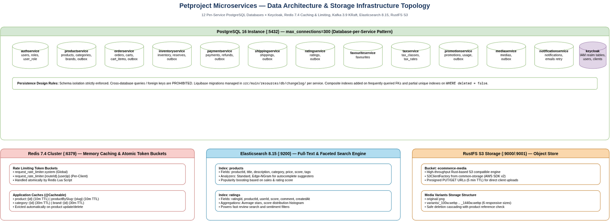

| Service | Port | Database | Primary responsibilities | Core technologies | Healthcheck endpoint |
|---|:---:|---|---|---|---|
| **`gateway-service`** | `8080` | *None* (Redis) | Edge router, OAuth2 JWT validation, two-tier Redis token bucket rate limiting, admin IP allowlisting, correlation ID injection | Spring Cloud Gateway, Netty, Redis, Bucket4j | `http://localhost:8080/actuator/health` |
| **`auth-service`** | `8088` | `authservice` | ROPC authentication, token refresh, user registration, Keycloak admin synchronization, user address book management | Spring Boot 4, Keycloak Admin Client, PostgreSQL, Liquibase | `http://localhost:8088/actuator/health` |
| **`product-service`** | `8086` | `productservice` | Product catalog, multi-level category trees, brand management, SPU/SKU variants, Redis caching, transactional outbox publishing | Spring Boot 4, Redis, PostgreSQL, Kafka, Liquibase | `http://localhost:8086/actuator/health` |
| **`inventory-service`** | `8082` | `inventoryservice` | Stock allocations, two-phase reservations (`/reserve`, `/commit`, `/release`), scheduled expiration sweeper | Spring Boot 4, PostgreSQL, Kafka, Liquibase | `http://localhost:8082/actuator/health` |
| **`order-service`** | `8084` | `orderservice` | Customer carts, checkout choreography saga, order state transitions, RMA returns, Resilience4j circuits | Spring Boot 4, Resilience4j, PostgreSQL, Kafka, Liquibase | `http://localhost:8084/actuator/health` |
| **`payment-service`** | `8085` | `paymentservice` | Payment creation, Stripe PaymentIntent integration, webhook verification, refunds, provider abstraction (Stripe, COD) | Spring Boot 4, Stripe Java SDK, PostgreSQL, Kafka | `http://localhost:8085/actuator/health` |
| **`shipping-service`** | `8087` | `shippingservice` | Shipment records, tracking number generation, carrier webhook ingestion, delivery state machine | Spring Boot 4, PostgreSQL, Kafka, Liquibase | `http://localhost:8087/actuator/health` |
| **`rating-service`** | `8089` | `ratingservice` | 1-5 star reviews, verified purchaser check via `order-service`, review moderation (hide/unhide) | Spring Boot 4, PostgreSQL, Kafka, Liquibase | `http://localhost:8089/actuator/health` |
| **`search-service`** | `8094` | *Elasticsearch* | BM25 full-text search, prefix autocomplete suggestions, real-time index synchronization from Kafka events | Spring Boot 4, Elasticsearch 8.15 Java Client | `http://localhost:8094/actuator/health` |
| **`tax-service`** | `8091` | `taxservice` | Tax classes, jurisdiction tax rates by country, state, and postal code, tax calculation endpoint | Spring Boot 4, PostgreSQL, Liquibase | `http://localhost:8091/actuator/health` |
| **`promotion-service`** | `8093` | `promotionservice` | Marketing campaigns, percentage and fixed coupons, minimum order constraints, two-phase coupon usage reservation | Spring Boot 4, PostgreSQL, Kafka, Liquibase | `http://localhost:8093/actuator/health` |
| **`favourite-service`** | `8081` | `favouriteservice` | Customer wishlist management, item add/remove operations, customer-product relationship checks | Spring Boot 4, PostgreSQL, Liquibase | `http://localhost:8081/actuator/health` |
| **`media-service`** | `8083` | `mediaservice` | Media uploads, magic-byte MIME type validation, generation of 6 WebP responsive variants, RustFS S3 storage | Spring Boot 4, RustFS/S3 SDK, ImageIO/WebP, PostgreSQL | `http://localhost:8083/actuator/health` |
| **`notification-service`** | `8090` | `notificationservice` | Event-driven customer notifications, in-app notification records, HTML email dispatch via SMTP | Spring Boot 4, JavaMailSender, PostgreSQL, Kafka | `http://localhost:8090/actuator/health` |

---

## 3. Business and functional flows

The system architecture coordinates 9 primary business workflows across services.

### Flow 1: Authentication and edge routing

Clients obtain tokens through `auth-service` via Resource Owner Password Credentials (ROPC) or refresh tokens. The service proxies credentials to Keycloak, synchronizes profile data to the local PostgreSQL shadow table, and returns JWT tokens to the client. Subsequent business requests pass through `gateway-service`, where the reactive pipeline validates the token signature against Keycloak JWKS, checks Redis rate limits, and routes the call downstream.

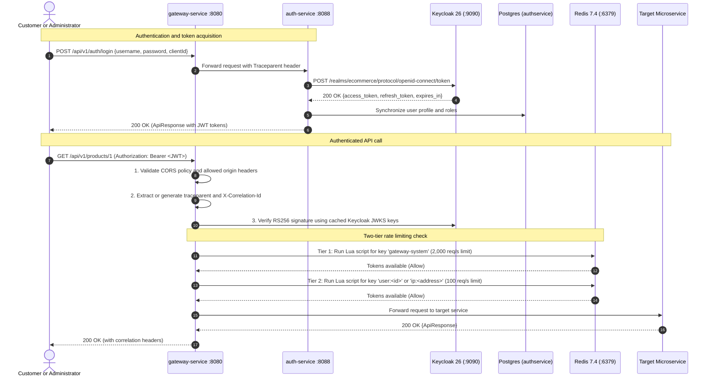

---

### Flow 2: Product catalog and search synchronization

When catalog managers create, update, or remove products, `product-service` writes the changes and records an event in the `outbox_events` table within a single ACID transaction. A background scheduler reads pending outbox entries, publishes them to Kafka topic `shop.product.lifecycle.v1`, and marks the entries processed. `search-service` consumes the events to keep Elasticsearch indices in sync.

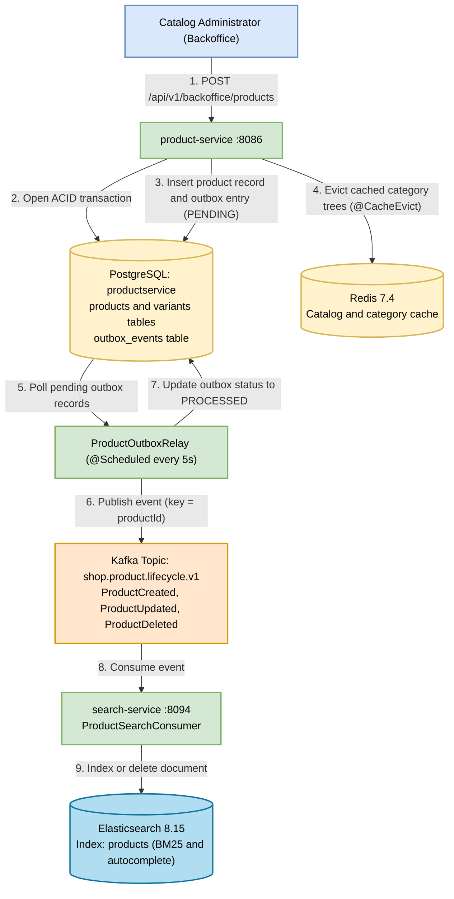

---

### Flow 3: Media processing pipeline

`media-service` handles file uploads with magic-byte validation to detect the true MIME type, preventing extension spoofing. It uploads original images to RustFS (S3-compatible object storage), generates 6 responsive WebP variants, stores metadata in PostgreSQL, and issues presigned download URLs.

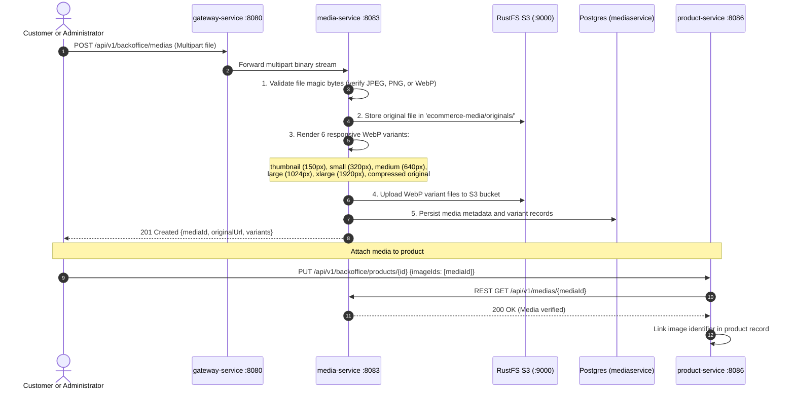

---

### Flow 4: Wishlist, shopping cart, and pricing

Shoppers browse items, save items to their wishlist in `favourite-service`, and build a persistent shopping cart in `order-service`. During cart reviews, `order-service` calls `promotion-service` to validate promotional discounts and calls `tax-service` to compute regional sales taxes.

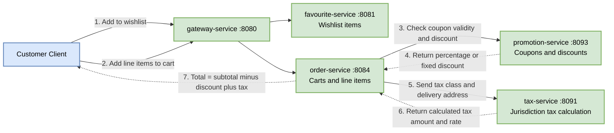

---

### Flow 5: Checkout and two-phase inventory reservation

When a shopper checks out, `order-service` orchestrates pre-order checks against product status, promotions, and taxes. It then reserves the required stock in `inventory-service` using a 15-minute expiring hold. Once the order is saved as `PENDING_PAYMENT`, an event is emitted via the transactional outbox to notify downstream systems.

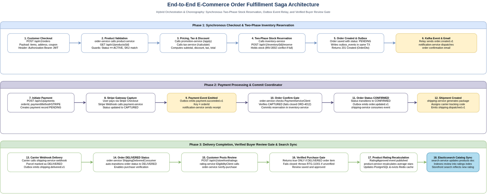

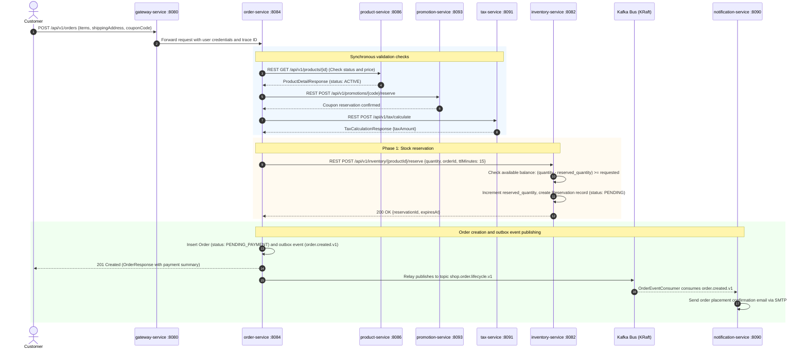

---

### Flow 6: Stripe payments and order confirmation

The customer initiates payment through `payment-service`, which opens a Stripe PaymentIntent. After payment completion on the client or via Stripe Checkout, Stripe calls the payment webhook. `payment-service` validates the HMAC signature, updates the record to `CAPTURED`, and emits `payment.captured.v1`. `order-service` (via `PaymentLifecycleConsumer` or REST confirmation hook) commits the reserved inventory in Phase 2 and marks the order `CONFIRMED`.

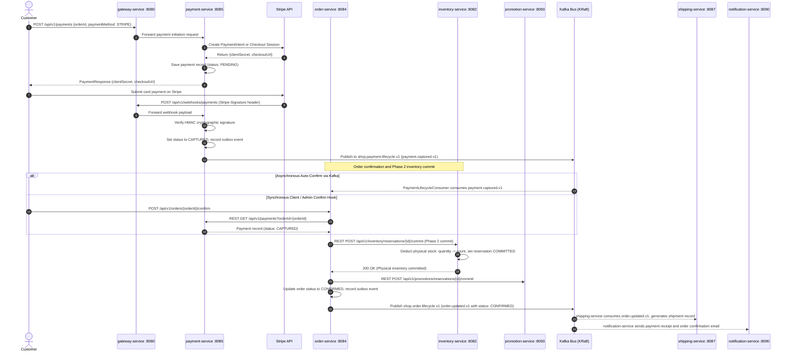

---

### Flow 7: Shipment fulfillment and delivery updates

When `order-service` publishes a `CONFIRMED` order event, `shipping-service` automatically generates a shipment entry and assigns a carrier tracking number. As the package moves through transit, carrier webhooks update the status to `DELIVERED`. `order-service` consumes this event to finalize the order.

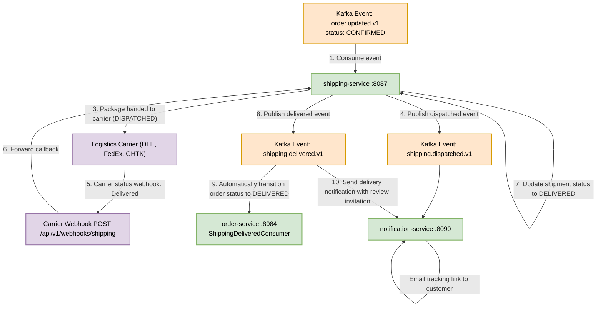

---

### Flow 8: Verified buyer ratings and reviews

Customers can rate and review items they have purchased. To prevent spam and fake reviews, `rating-service` checks purchase history with `order-service` via the verified buyer gate. Once validated and approved, average rating metrics update in the product catalog and feed into Elasticsearch search rankings.

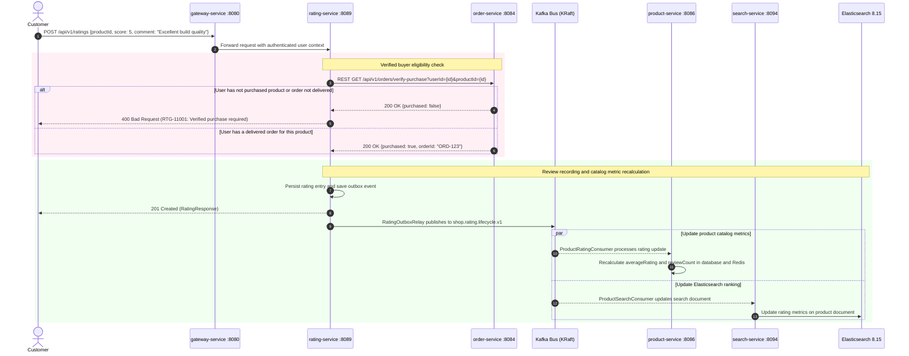

---

### Flow 9: Expired stock sweepers and compensations

The system handles network failures, order cancellations, and abandoned checkouts through automated background sweepers and compensation flows.

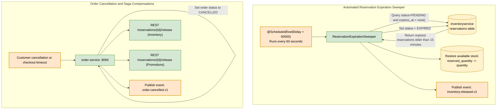

---

## 4. Event-driven messaging backbone

The messaging platform uses an Apache Kafka 3.9 cluster in KRaft mode. Event producers write events to an outbox table in their local database, and background workers publish them using business entity IDs as partition keys to guarantee in-order delivery per aggregate.

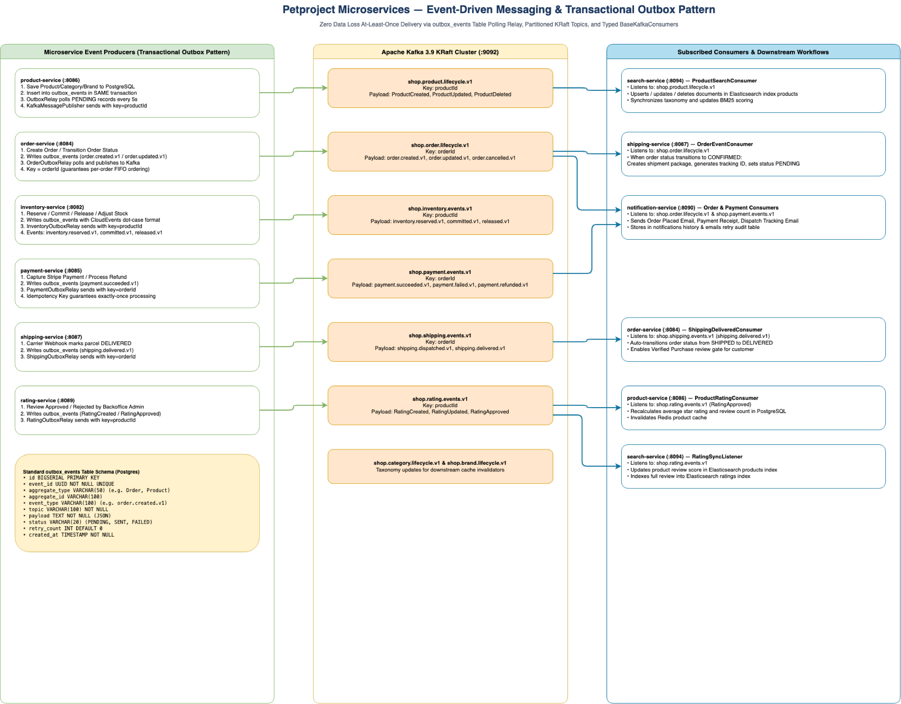

| Kafka topic | Producer | Partition key | Event types | Consumers and actions |
|---|---|---|---|---|
| **`shop.order.lifecycle.v1`** | `order-service` | `orderId` | `order.created.v1`<br/>`order.updated.v1`<br/>`order.cancelled.v1` | **`shipping-service`**: Generates shipment when order reaches `CONFIRMED`.<br/>**`notification-service`**: Sends order placement and status update emails. |
| **`shop.product.lifecycle.v1`** | `product-service` | `productId` | `ProductCreated`<br/>`ProductUpdated`<br/>`ProductDeleted` | **`search-service`**: Indexes, modifies, or removes Elasticsearch product documents. |
| **`shop.category.lifecycle.v1`** | `product-service` | `categoryId` | `CategoryCreated`<br/>`CategoryUpdated`<br/>`CategoryDeleted` | **Catalog subscribers**: Internal cache invalidation. |
| **`shop.brand.lifecycle.v1`** | `product-service` | `brandId` | `BrandCreated`<br/>`BrandUpdated`<br/>`BrandDeleted` | **Catalog subscribers**: Internal cache invalidation. |
| **`shop.inventory.events.v1`** | `inventory-service` | `productId` | `inventory.reserved.v1`<br/>`inventory.committed.v1`<br/>`inventory.released.v1` | **Audit consumers**: Track inventory movements and stock levels. |
| **`shop.payment.lifecycle.v1`** | `payment-service` | `orderId` | `payment.captured.v1`<br/>`payment.failed.v1`<br/>`payment.refunded.v1` | **`notification-service`**: Dispatches payment receipts or failure alerts.<br/>**`order-service`**: `PaymentLifecycleConsumer` auto-confirms order on `payment.captured.v1`. |
| **`shop.shipping.lifecycle.v1`** | `shipping-service` | `orderId` | `shipping.dispatched.v1`<br/>`shipping.delivered.v1` | **`order-service`**: Advances order status to `DELIVERED` on delivery confirmation.<br/>**`notification-service`**: Sends tracking numbers and shipment alerts. |
| **`shop.rating.lifecycle.v1`** | `rating-service` | `productId` | `RatingCreated`<br/>`RatingApproved`<br/>`RatingRejected` | **`product-service`**: Recalculates average star rating and review count.<br/>**`search-service`**: Updates search ranking scores in Elasticsearch. |
| **`shop.promotion.lifecycle.v1`** | `promotion-service` | `campaignId` | `PromotionCreated`<br/>`PromotionUpdated` | **Promotion subscribers**: Updates marketing campaigns. |
| **`media.lifecycle.v1`** | `media-service` | `mediaId` | `MediaDeleted` | **`product-service`**: Removes deleted image references from product galleries. |

---

## 5. Edge security and rate limiting

The edge tier (`gateway-service`) runs a non-blocking reactive filter pipeline to protect backend microservices against traffic spikes and abusive traffic patterns:

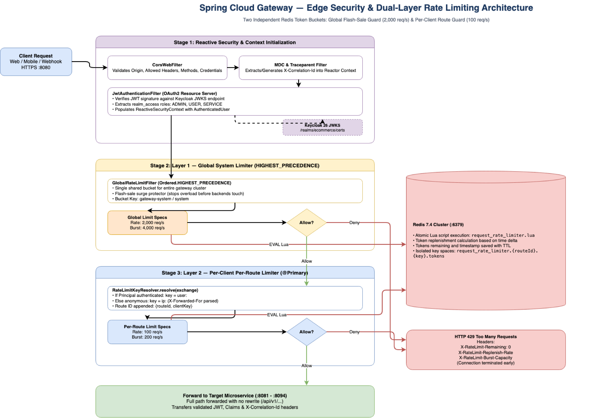

### Two-tier token bucket rate limiting:
1. **Tier 1: Global system limiter (cluster protection)**:
   - **Filter**: `GlobalRateLimitFilter` with order `Ordered.HIGHEST_PRECEDENCE`
   - **Key**: Static identifier `gateway-system`
   - **Limits**: 2,000 requests per second, burst capacity of 4,000 requests
   - **Purpose**: Protects total backend capacity against extreme traffic surges.
2. **Tier 2: Per-client and per-route limiter (fairness and scraping prevention)**:
   - **Filter**: `RequestRateLimiterGatewayFilterFactory` configured per route
   - **Key resolver**: `user:<uuid>` for authenticated clients, `ip:<remote-ip>` for anonymous visitors
   - **Limits**: 100 requests per second, burst capacity of 200 requests
   - **Purpose**: Restricts aggressive individual callers without degrading service for other clients.

When a client exceeds token availability at either layer, the gateway responds with HTTP 429 Too Many Requests without forwarding the call downstream.

---

## 6. Shared platform libraries (`utils/`)

Common standards for security, data contracts, error handling, logging, and infrastructure integrations are maintained across 8 modules in the `utils/` directory:

- **`common-core`**: Base contracts including `ApiResponse<T>`, system-wide `ErrorCode` enum, `PageResponse<T>`, and base exceptions.
- **`common-spring`**: Shared Spring Boot configuration, global `@RestControllerAdvice` error handlers, Swagger OpenAPI beans, Jackson serialization settings, and Micrometer metrics.
- **`common-security`**: Spring Security 6 resource server configuration, Keycloak JWT role converters (`ROLE_CUSTOMER`, `ROLE_ADMIN`), and security utility helpers.
- **`common-logging`**: Performance logging aspect (`@LogPerformance`), MDC context management, and W3C `traceparent` distributed trace propagation.
- **`common-keycloak`**: Keycloak REST client wrappers for user authentication, session revocation, and administrative user provisioning.
- **`common-kafka`**: Central Kafka producer and consumer configurations, base consumer templates, dead-letter queue policies, and retry backoff.
- **`common-storage`**: S3-compatible storage client abstraction for uploads, deletes, and presigned URL generation with RustFS and AWS S3.
- **`common-patterns`**: Architectural verification suites for fleet pattern compliance.

---

## 7. Local development guide

### Prerequisites

- **Operating system**: macOS (Apple Silicon or Intel), Linux (Ubuntu 22.04+), or Windows 11 with WSL2.
- **Java runtime**: JDK 25 (Temurin LTS or OpenJDK 25).
- **Build tool**: Apache Maven 3.9+ or the included `./mvnw` wrapper.
- **Container engine**: Docker 24+ and Docker Compose v2+.
- **Memory**: 16 GB minimum, 32 GB recommended to run all 14 services alongside full infrastructure.

### Step 1: Start infrastructure containers

The repository includes a tuned Docker Compose configuration that starts 12 PostgreSQL databases, Redis, Kafka KRaft, Elasticsearch with basic credentials, Keycloak with realm auto-import, and RustFS S3 storage:

```bash
# 1. Create your local environment configuration file
cp .env.example .env

# 2. Launch core infrastructure in the background
docker compose up -d postgres redis kafka elasticsearch keycloak rustfs

# 3. Verify container health status
docker compose ps
```

### Step 2: Toolchain setup and compilation

The build relies on Maven JDK toolchains to enforce compilation against Java 25.

1. **Configure toolchain (create or verify `~/.m2/toolchains.xml`)**:
   ```xml
   <?xml version="1.0" encoding="UTF-8"?>
   <toolchains xmlns="http://maven.apache.org/TOOLCHAINS/1.1.0"
              xmlns:xsi="http://www.w3.org/2001/XMLSchema-instance"
              xsi:schemaLocation="http://maven.apache.org/TOOLCHAINS/1.1.0 http://maven.apache.org/xsd/toolchains-1.1.0.xsd">
       <toolchain>
           <type>jdk</type>
           <provides>
               <version>25</version>
               <vendor>temurin</vendor>
           </provides>
           <configuration>
               <jdkHome>/path/to/your/java-25</jdkHome>
           </configuration>
       </toolchain>
   </toolchains>
   ```

2. **Compile and validate source formatting**:
   ```bash
   # Compile all 23 modules
   ./mvnw clean compile

   # Verify source formatting against Checkstyle rules
   ./mvnw -T1C validate
   ```

### Step 3: Launch microservices

Services can be run locally via Maven or packaged into container images:

- **Run an individual service for local development**:
   ```bash
   # Run Gateway Service on :8080
   ./mvnw -pl gateway-service spring-boot:run

   # Run Auth Service on :8088
   ./mvnw -pl auth-service spring-boot:run

   # Run Product Service on :8086
   ./mvnw -pl product-service spring-boot:run
   ```

- **Build images with Jib and start the entire fleet via Docker**:
   ```bash
   # Build container images directly to the local Docker daemon
   ./mvnw clean package jib:dockerBuild -DskipTests

   # Start all 14 services and infrastructure containers
   docker compose up -d
   ```

---

## 8. Testing and observability

### Postman and Newman test collections
The repository includes a comprehensive Postman test suite (`docs/postman/petproject-comprehensive.postman_collection.json`) containing 190 automated test cases organized into 3 sections:
1. **End-to-end business lifecycle (41 requests)**: Full checkout flow from authentication, catalog search, inventory hold, cart checkout, multi-gateway payments (Stripe, COD), shipping tracking, verified reviews, and RMA returns.
2. **Edge cases and security audits (23 requests)**: Tests for 401 Unauthorized handling, 403 Forbidden role restrictions, validation errors (negative prices, missing fields), 409 reservation conflicts, and HMAC webhook signature checks.
3. **Fleet service catalog (126 requests)**: Endpoint verification across all 14 microservices.

```bash
# Execute the full 190-request test suite
npx --yes newman run docs/postman/petproject-comprehensive.postman_collection.json

# Execute the core business flow test suite
npx --yes newman run docs/postman/petproject-e2e-business-flow.postman_collection.json --bail
```

### Swagger OpenAPI documentation
When services are running, interactive OpenAPI documentation is available directly on each service port:
- Gateway Service: `http://localhost:8080/swagger-ui.html`
- Auth Service: `http://localhost:8088/swagger-ui.html`
- Product Service: `http://localhost:8086/swagger-ui.html`
- Order Service: `http://localhost:8084/swagger-ui.html`
- Inventory Service: `http://localhost:8082/swagger-ui.html`
- Payment Service: `http://localhost:8085/swagger-ui.html`
- Shipping Service: `http://localhost:8087/swagger-ui.html`
- Rating Service: `http://localhost:8089/swagger-ui.html`
- Promotion Service: `http://localhost:8093/swagger-ui.html`
- Tax Service: `http://localhost:8091/swagger-ui.html`
- Search Service: `http://localhost:8094/swagger-ui.html`
- Media Service: `http://localhost:8083/swagger-ui.html`
- Favourite Service: `http://localhost:8081/swagger-ui.html`
- Notification Service: `http://localhost:8090/swagger-ui.html`

### Health checks and metrics
All microservices expose standard Spring Boot Actuator endpoints:
- Health checks: `GET http://localhost:<port>/actuator/health`
- Prometheus metrics: `GET http://localhost:<port>/actuator/prometheus`
- Application details: `GET http://localhost:<port>/actuator/info`

---

## 9. Technical architecture blueprints

For detailed documentation, architecture decision records, and editable Draw.io source diagrams, see the `docs/` directory:

- [Master architecture analysis (`docs/architecture/MASTER_ARCHITECTURE_ANALYSIS.md`)](./docs/architecture/MASTER_ARCHITECTURE_ANALYSIS.md)
- [System landscape blueprint (`docs/FULL-ARCHITECTURE.md`)](./docs/FULL-ARCHITECTURE.md)
- [Draw.io and SVG architecture diagrams (`docs/architecture/`)](./docs/architecture/)
  - [System landscape architecture (Draw.io)](./docs/architecture/system-landscape-architecture.drawio)
  - [Event-driven messaging and outbox (Draw.io)](./docs/architecture/event-driven-messaging-architecture.drawio)
  - [End-to-end order fulfillment saga (Draw.io)](./docs/architecture/e2e-order-fulfillment-saga.drawio)
  - [Gateway security and rate limiting (Draw.io)](./docs/architecture/gateway-security-rate-limit.drawio)
  - [Data stores and infrastructure topology (Draw.io)](./docs/architecture/data-stores-infrastructure-topology.drawio)
- [Gateway rate limiting guide (`docs/RATE-LIMIT.md`)](./docs/RATE-LIMIT.md)
- [Architecture design patterns (`docs/PATTERNS.md`)](./docs/PATTERNS.md)
- [Production readiness checklist (`docs/PRODUCTION-READINESS.md`)](./docs/PRODUCTION-READINESS.md)

---

<p align="center">
  <b>Petproject Microservices Platform</b>: Built with Java 25 and Spring Boot 4.1.1
</p>
