# Master Architecture Analysis Report: Petproject Microservices Platform
## Distributed E-Commerce Architecture

> **Comprehensive architectural analysis of the cloud-native distributed e-commerce system**
> **Technology stack**: Java 25 (LTS), Spring Boot 4.1.1, Spring Cloud Gateway, Apache Kafka 3.9 (KRaft), PostgreSQL 16, Redis 7.4, Elasticsearch 8.15, Keycloak 26, RustFS S3
> **Architecture visualization tools**: Archify Showcase Engine, Mermaid Vector Diagrams

---

## Table of Contents

1. [System Overview and Catalog of 14 Microservices and Infrastructure](#1-system-overview-and-catalog-of-14-microservices-and-infrastructure)
2. [System Landscape Architecture Diagram](#2-system-landscape-architecture-diagram)
3. [Deep-Dive Execution Flows (10 Core Workflows)](#3-deep-dive-execution-flows-10-core-workflows)
   - [Flow 1: Authentication and Edge Gateway Routing (Keycloak ROPC and Dual Rate Limiting)](#flow-1-authentication-and-edge-gateway-routing-keycloak-ropc-and-dual-rate-limiting)
   - [Flow 2: Product Catalog and CDC Search Synchronization (Transactional Outbox and Elasticsearch BM25)](#flow-2-product-catalog-and-cdc-search-synchronization-transactional-outbox-and-elasticsearch-bm25)
   - [Flow 3: Media Processing Pipeline and Responsive WebP Variants (RustFS S3)](#flow-3-media-processing-pipeline-and-responsive-webp-variants-rustfs-s3)
   - [Flow 4: Customer Experience: Wishlist, Shopping Cart, and Dynamic Pricing Engine](#flow-4-customer-experience-wishlist-shopping-cart-and-dynamic-pricing-engine)
   - [Flow 5: Order Checkout and Two-Phase Stock Reservation Saga (Phase 1)](#flow-5-order-checkout-and-two-phase-stock-reservation-saga-phase-1)
   - [Flow 6: Multi-Gateway Payment Processing and Order Confirmation (Stripe Webhooks and Phase 2 Commit)](#flow-6-multi-gateway-payment-processing-and-order-confirmation-stripe-webhooks-and-phase-2-commit)
   - [Flow 7: Shipping Logistics, Carrier Integration, and Auto-Delivery](#flow-7-shipping-logistics-carrier-integration-and-auto-delivery)
   - [Flow 8: Verified Buyer Rating and Search Ranking Updates (Eligibility Gate RTG-11001)](#flow-8-verified-buyer-rating-and-search-ranking-updates-eligibility-gate-rtg-11001)
   - [Flow 9: Expired Stock Sweepers, Cancellations, and Saga Compensations](#flow-9-expired-stock-sweepers-cancellations-and-saga-compensations)
   - [Flow 10: Closed-Loop Return Merchandise Authorization (RMA) Workflow](#flow-10-closed-loop-return-merchandise-authorization-rma-workflow)
4. [Event-Driven Messaging Backbone and Kafka Topic Matrix](#4-event-driven-messaging-backbone-and-kafka-topic-matrix)
5. [Database-per-Service Storage and Resilience Architecture](#5-database-per-service-storage-and-resilience-architecture)
6. [Archify Interactive Diagram Audit Report](#6-archify-interactive-diagram-audit-report)
7. [Archify Interactive Showcase Diagrams Directory](#7-archify-interactive-showcase-diagrams-directory)

---

## 1. System Overview and Catalog of 14 Microservices and Infrastructure

The **Petproject Microservices Platform** is organized as a **Maven Reactor Multi-Module project with 23 modules**:
- **14 independent microservices**, each dedicated to a distinct business domain.
- **8 shared platform libraries (`utils/`)** standardizing exception handling, security, Kafka messaging, logging, and object storage.
- **1 root aggregator POM**.

All services follow the **Database-per-Service pattern**. They do not share physical database tables and communicate via REST clients (wrapped in Resilience4j circuit breakers) and Apache Kafka in KRaft mode.

### Catalog of 14 Microservices

| Index | Service | Port | Database | Domain responsibilities | Core technologies | Inter-service dependencies |
|:---:|---|:---:|---|---|---|---|
| 1 | **`gateway-service`** | `8080` | *None* (Redis) | Single edge entrypoint, passes `/api/v1/*` without prefix stripping, validates Keycloak JWTs, two-tier rate limiting (global 2000 req/s, client 100 req/s), stamps `X-Correlation-Id`. | Spring Cloud Gateway, Netty, Redis Lua, Resilience4j | Routes to all 13 backend services |
| 2 | **`auth-service`** | `8088` | `authservice` | Keycloak ROPC login, token refresh, registration, local user synchronization, delivery address book management (`UserAddress`). | Spring Boot 4, Keycloak Admin Client, Spring Data JPA | Keycloak Admin REST API (:9090) |
| 3 | **`product-service`** | `8086` | `productservice` | Hierarchical category trees, brand catalog, SPU and SKU variants, Redis caching (`@Cacheable`), transactional outbox publishing. | Spring Boot 4, Redis, PostgreSQL, Kafka Outbox | `media-service` (:8083) |
| 4 | **`inventory-service`** | `8082` | `inventoryservice` | Warehouse stock tracking, two-phase reservation (`/reserve`, `/commit`, `/release`), scheduled sweeper for expired holds. | Spring Boot 4, Scheduled Sweeper, Kafka Outbox | Receives calls from `order-service` |
| 5 | **`order-service`** | `8084` | `orderservice` | Shopping carts, checkout choreography saga, idempotency key enforcement, Resilience4j-wrapped RestClients, RMA return processing. | Spring Boot 4, Resilience4j, Kafka Outbox & Consumers | `product`, `inventory`, `promotion`, `tax`, `payment` |
| 6 | **`payment-service`** | `8085` | `paymentservice` | Stripe PaymentIntent, VNPay, MoMo, COD, Stripe HMAC webhook signature validation, payment lifecycle management, refunds. | Spring Boot 4, Stripe SDK, Kafka Outbox | Stripe API, external webhooks |
| 7 | **`shipping-service`** | `8087` | `shippingservice` | Ingests confirmed orders, creates shipment records and tracking numbers, carrier integrations (GHN, GHTK, DHL), status webhooks. | Spring Boot 4, Carrier Adapters, Kafka Outbox | Kafka `shop.order.lifecycle.v1` |
| 8 | **`rating-service`** | `8089` | `ratingservice` | 1-5 star ratings with customer reviews, verified purchaser check (`RTG-11001` via `order-service`), review moderation. | Spring Boot 4, RestClient, Kafka Outbox | `order-service` (:8084 `/verify-purchase`) |
| 9 | **`search-service`** | `8094` | *Elasticsearch* | BM25 search engine, edge n-gram autocomplete suggestions, multi-facet filtering, real-time CDC synchronization. | Spring Boot 4, Elasticsearch 8.15 Java Client | `product-service` (:8086 reindex), Kafka |
| 10 | **`tax-service`** | `8091` | `taxservice` | Tax classes, real-time tax calculation by product class and geographic destination (country, state, postal code). | Spring Boot 4, Spring Data JPA, PostgreSQL | Provides calculation API to `order-service` |
| 11 | **`promotion-service`** | `8093` | `promotionservice` | Marketing campaigns, discount coupons (percentage or fixed amount), minimum order rules, two-phase coupon usage reservation. | Spring Boot 4, Spring Data JPA, PostgreSQL | Provides reservation API to `order-service` |
| 12 | **`favourite-service`** | `8081` | `favouriteservice` | Customer wishlist management, item bookmarks, paginated saved item queries. | Spring Boot 4, Spring Data JPA, PostgreSQL | Looks up customer ID from JWT |
| 13 | **`media-service`** | `8083` | `mediaservice` | Multipart media uploads, magic-byte MIME validation against file spoofing, automated generation of 3 responsive variants (original/display/thumb), each stored in the source format AND in WebP - 6 objects for a JPEG/PNG upload, 3 for a WebP upload, presigned S3 URLs. | Spring Boot 4, RustFS/S3 SDK, ImageIO WebP | `product-service` (reference validation) |
| 14 | **`notification-service`** | `8090` | `notificationservice` | Multi-channel notifications (in-app alerts, SMTP emails), automatic order confirmation, payment receipts, delivery updates. | Spring Boot 4, JavaMailSender, Kafka Consumers | Kafka topics (order, payment, shipping) |

---

### Infrastructure and Distributed Data Stores

| Component | Technology | Network ports | Storage targets | Operational purpose |
|---|---|:---:|---|---|
| **Relational Database** | PostgreSQL 16 Alpine | `5432` | 12 Service DBs: `authservice`, `productservice`, `orderservice`, `inventoryservice`, `paymentservice`, `shippingservice`, `ratingservice`, `favouriteservice`, `taxservice`, `promotionservice`, `mediaservice`, `notificationservice` + `keycloak` | ACID relational storage per microservice. Configured with `max_connections=300`. |
| **In-Memory Cache & Limiter** | Redis 7.4 Alpine | `6379` | `db: 0` (Key patterns: `request_rate_limiter.*`, `product::*`, `category::*`) | Atomic Lua script execution for two-tier rate limiting at the gateway; catalog and category caching; SSO session storage. |
| **Distributed Event Bus** | Apache Kafka 3.9 | `9092` | Topics: `shop.order.lifecycle.v1`, `shop.product.lifecycle.v1`, `shop.inventory.events.v1`, `shop.payment.lifecycle.v1`, `shop.shipping.events.v1`, `shop.rating.events.v1`, `shop.media.lifecycle.v1` | Operates in **KRaft mode** without Zookeeper (`node_id=1`). Delivers asynchronous events and outbox CDC records with in-order partition key delivery. |
| **Full-Text Search Engine** | Elasticsearch 8.15 | `9200` | Indices: `products`, `ratings` | BM25 search queries, prefix autocomplete suggestions, multi-attribute catalog filtering. |
| **Identity & Access Management** | Keycloak 26 | `8080` (internal) / `9090` (host) | Realm: `ecommerce` (Clients: `shop-client`, `gateway-client`, `admin-cli`) | Centralized OAuth2/OIDC identity provider, issues RS256-signed JWT tokens, manages realm roles (`ROLE_CUSTOMER`, `ROLE_ADMIN`). |
| **Object Storage** | RustFS (S3 compatible) | `9000` (API) / `9001` (Console) | Bucket: `ecommerce-media` (Prefixes: `originals/`, `variants/`) | High-throughput object storage for original media and responsive WebP image variants with presigned access URLs. |

---

### Shared Platform Libraries (`utils/`)

1. **`common-core`**: Defines the uniform `ApiResponse<T>` envelope (`success`, `code`, `message`, `data`, `errors`, `path`, `traceId`, `timestamp`), system-wide `ErrorCode` enumeration, `PageResponse<T>`, and base exceptions.
2. **`common-spring`**: Shared Spring Boot starter providing bean validation, global exception handlers, Swagger OpenAPI 3.1, Jackson ISO-8601 formatting, ModelMapper, Dotenv loader, and Micrometer metrics.
3. **`common-security`**: Spring Security 6 resource server configuration, Keycloak realm role converters (`ROLE_CUSTOMER`, `ROLE_ADMIN`), and security helper utilities.
4. **`common-logging`**: Performance logging aspect (`@LogPerformance`), W3C `traceparent` extraction, and MDC correlation context management.
5. **`common-keycloak`**: Keycloak Admin Client abstraction for account provisioning, role assignments, and realm maintenance.
6. **`common-kafka`**: Standardized producer and consumer configurations, `BaseKafkaConsumer` with exponential backoff, dead-letter queue routing, and idempotency safeguards.
7. **`common-storage`**: S3 client abstraction for upload operations, deletes, object checks, and presigned download URL generation.
8. **`utils` (Aggregator)**: Parent POM managing dependency versions across all shared platform libraries.

---

## 2. System Landscape Architecture Diagram

```mermaid
flowchart TB
    classDef clientClass fill:#dae8fc,stroke:#6c8ebf,stroke-width:2px,color:#000000;
    classDef gatewayClass fill:#ffe6cc,stroke:#d79b00,stroke-width:2px,color:#000000;
    classDef authClass fill:#e1d5e7,stroke:#9673a6,stroke-width:2px,color:#000000;
    classDef coreServiceClass fill:#d5e8d4,stroke:#82b366,stroke-width:2px,color:#000000;
    classDef cxServiceClass fill:#b1ddf0,stroke:#10739e,stroke-width:2px,color:#000000;
    classDef pricingServiceClass fill:#fad7ac,stroke:#b46504,stroke-width:2px,color:#000000;
    classDef fulfillServiceClass fill:#d0cee2,stroke:#56517e,stroke-width:2px,color:#000000;
    classDef busClass fill:#fff2cc,stroke:#d6b656,stroke-width:2px,color:#000000;
    classDef storeClass fill:#f5f5f5,stroke:#666666,stroke-width:2px,color:#000000;
    classDef extClass fill:#f8cecc,stroke:#b85450,stroke-width:2px,stroke-dasharray: 4 4,color:#000000;

    subgraph CLIENTS ["Client Layer and External Callers"]
        WEB["Web Application (React / Vue)"]:::clientClass
        MOBILE["Mobile Application (Flutter / React Native)"]:::clientClass
        ADMIN_UI["Backoffice Admin UI"]:::clientClass
        STRIPE_EXT["Stripe Payment Gateway"]:::extClass
        CARRIER_EXT["Logistics Carriers (GHN, GHTK, DHL)"]:::extClass
    end

    subgraph EDGE ["Edge Tier"]
        GW["gateway-service :8080<br/>Two-tier token bucket rate limiting (Redis Lua)<br/>OAuth2 JWT signature verification (Keycloak JWKS)<br/>Distributed tracing (X-Correlation-Id / MDC)<br/>Routes /api/v1/* without prefix stripping"]:::gatewayClass
    end

    subgraph IAM ["Identity and Access Tier"]
        KEYCLOAK["Keycloak 26 IAM (:9090)<br/>Realm: ecommerce<br/>RS256 JWT tokens and JWKS"]:::authClass
        AUTH_SVC["auth-service :8088<br/>ROPC login, token refresh, address book, mirror DB"]:::authClass
    end

    subgraph CORE_COMMERCE ["Core Commerce Domain"]
        PRODUCT_SVC["product-service :8086<br/>Catalog, category trees, SKU variants, Redis cache"]:::coreServiceClass
        INV_SVC["inventory-service :8082<br/>Two-phase stock reservation, auto-release sweeper"]:::coreServiceClass
        ORDER_SVC["order-service :8084<br/>Shopping carts, order saga coordination, RMA returns"]:::coreServiceClass
    end

    subgraph CUSTOMER_EXP ["Customer Experience Domain"]
        SEARCH_SVC["search-service :8094<br/>Elasticsearch 8.15 BM25 and autocomplete"]:::cxServiceClass
        RATING_SVC["rating-service :8089<br/>Reviews and verified buyer validation RTG-11001"]:::cxServiceClass
        FAV_SVC["favourite-service :8081<br/>Customer wishlists and saved items"]:::cxServiceClass
    end

    subgraph PRICING_MEDIA ["Pricing, Tax, and Media Domain"]
        TAX_SVC["tax-service :8091<br/>Tax categories and jurisdiction calculation engine"]:::pricingServiceClass
        PROMO_SVC["promotion-service :8093<br/>Campaigns, coupon codes, and usage holds"]:::pricingServiceClass
        MEDIA_SVC["media-service :8083<br/>Magic-byte sniffing and 3 responsive variants (source format + WebP)"]:::pricingServiceClass
    end

    subgraph FULFILLMENT ["Fulfillment and Messaging Domain"]
        PAY_SVC["payment-service :8085<br/>Stripe, VNPay, MoMo, COD, HMAC webhook verification"]:::fulfillServiceClass
        SHIP_SVC["shipping-service :8087<br/>Shipment creation, tracking codes, carrier webhooks"]:::fulfillServiceClass
        NOTIF_SVC["notification-service :8090<br/>In-app notifications and automated SMTP emails"]:::fulfillServiceClass
    end

    subgraph EVENT_BUS ["Event Streaming Backbone"]
        KAFKA["Apache Kafka 3.9 (KRaft Cluster :9092)<br/>Topics: order, product, category, brand, inventory,<br/>payment, shipping, rating, media"]:::busClass
    end

    subgraph PERSISTENCE ["Database-per-Service Datastores"]
        PG[("PostgreSQL 16 (:5432)<br/>12 isolated databases:<br/>authservice, productservice, orderservice, inventoryservice,<br/>paymentservice, shippingservice, ratingservice, favouriteservice,<br/>taxservice, promotionservice, mediaservice, notificationservice")]:::storeClass
        REDIS[("Redis 7.4 (:6379)<br/>Token buckets, product cache, SSO sessions")]:::storeClass
        ES[("Elasticsearch 8.15 (:9200)<br/>Product and review search indices")]:::storeClass
        RUSTFS[("RustFS S3 (:9000)<br/>Bucket: ecommerce-media (originals and WebP variants)")]:::storeClass
    end

    %% Clients to Gateway
    WEB & MOBILE & ADMIN_UI -->|"HTTP REST /api/v1/*"| GW
    STRIPE_EXT -->|"Webhook POST"| GW
    CARRIER_EXT -->|"Webhook POST"| GW

    %% Edge to Services
    GW -.->|"JWT signature check via JWKS"| KEYCLOAK
    GW -->|"Atomic Lua script execution"| REDIS
    GW --> AUTH_SVC & PRODUCT_SVC & INV_SVC & ORDER_SVC & SEARCH_SVC & RATING_SVC & FAV_SVC & TAX_SVC & PROMO_SVC & MEDIA_SVC & PAY_SVC & SHIP_SVC & NOTIF_SVC
    AUTH_SVC <-->|"Keycloak Admin REST API"| KEYCLOAK

    %% Synchronous Orchestration (RestClient with Resilience4j)
    ORDER_SVC -->|"REST GET /api/v1/products/{id}"| PRODUCT_SVC
    ORDER_SVC -->|"REST POST /reserve and /commit"| INV_SVC
    ORDER_SVC -->|"REST POST /promotions/apply"| PROMO_SVC
    ORDER_SVC -->|"REST POST /tax-rates/calculate"| TAX_SVC
    ORDER_SVC -->|"REST GET /payments/order/{id}"| PAY_SVC
    RATING_SVC -->|"REST GET /verify-purchase (RTG-11001)"| ORDER_SVC
    PRODUCT_SVC <-->|"REST head / validate media"| MEDIA_SVC

    %% Asynchronous Outbox Event Publishing
    PRODUCT_SVC & INV_SVC & ORDER_SVC & PAY_SVC & SHIP_SVC & RATING_SVC & PROMO_SVC & MEDIA_SVC -->|"Transactional outbox relay"| KAFKA

    %% Asynchronous Event Consumption
    KAFKA -->|"CDC sync for products and ratings"| SEARCH_SVC
    KAFKA -->|"Order confirmed -> create shipment"| SHIP_SVC
    KAFKA -->|"Shipping delivered -> finalize order"| ORDER_SVC
    KAFKA -->|"Rating approved -> recompute score"| PRODUCT_SVC
    KAFKA -->|"Domain events -> dispatch emails and in-app alerts"| NOTIF_SVC

    %% Database Mappings
    AUTH_SVC & PRODUCT_SVC & INV_SVC & ORDER_SVC & PAY_SVC & SHIP_SVC & FAV_SVC & RATING_SVC & TAX_SVC & PROMO_SVC & MEDIA_SVC & NOTIF_SVC --> PG
    GW & PRODUCT_SVC <--> REDIS
    SEARCH_SVC <--> ES
    MEDIA_SVC <--> RUSTFS
```

---

## 3. Deep-Dive Execution Flows (10 Core Workflows)

Below is an analysis of each core workflow, covering classes, methods, parameters, data persistence, and sequence interactions.

---

### Flow 1: Authentication and Edge Gateway Routing (Keycloak ROPC and Dual Rate Limiting)

Handles client login, JWT token issuance, and three-layer security filtering at the API Gateway.

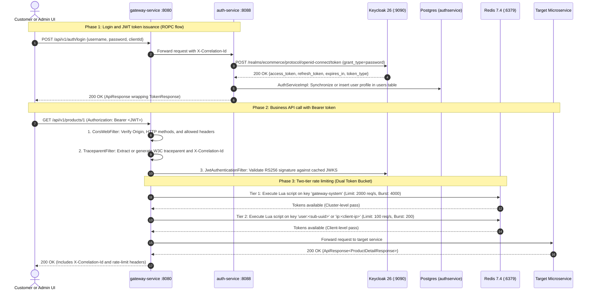

- **Endpoint**: `POST /api/v1/auth/login`
- **Request Body**: `LoginRequest { username: "customer1", password: "password123", clientId: "shop-client" }`
- **Processing Details**:
  - `gateway-service` receives the call and stamps `X-Correlation-Id` into the logging context.
  - `auth-service` (`AuthServiceImpl.login()`): Calls the Keycloak Token endpoint `/realms/ecommerce/protocol/openid-connect/token`.
  - Extracts claims from the token (`sub`, `preferred_username`, `email`, `realm_access.roles`).
  - `UserRepository.findByUsername()`: Inserts a local `User` record if absent, maintaining the user mirror pattern.
- **Persistence**:
  - PostgreSQL `authservice`: `users` table (`id`, `username`, `email`, `first_name`, `last_name`) and `user_roles`.
- **Response**: `200 OK` wrapped in `ApiResponse<TokenResponse>` with `{ accessToken, refreshToken, expiresIn, tokenType: "Bearer" }`.

---

### Flow 2: Product Catalog and CDC Search Synchronization (Transactional Outbox and Elasticsearch BM25)

When catalog administrators modify categories or products, transactional outbox publishing guarantees consistency between PostgreSQL and Kafka. `search-service` consumes these records to update Elasticsearch.

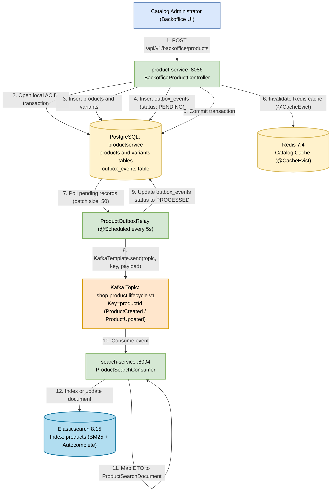

- **Endpoint**: `POST /api/v1/backoffice/products` (Requires `Authorization: Bearer <ADMIN_JWT>`)
- **Request Body**: `ProductCreateRequest { name: "MacBook Pro M4", slug: "macbook-pro-m4", price: 1999.00, categoryId: 5, brandId: 2, variants: [...] }`
- **Processing Details**:
  - `ProductServiceImpl.createProduct()`: Executes inside a Spring `@Transactional` block.
  - Validates `categoryId` and `brandId`.
  - Persists product records and associated `product_variants`.
  - `TransactionalProductEventPublisher`: Creates an `OutboxEvent` (`aggregateType="PRODUCT"`, `eventType="ProductCreated"`, `payload=JSON`) in the same ACID transaction.
  - Evicts cached catalog trees with `@CacheEvict(value = "products", allEntries = true)`.
  - `ProductOutboxRelay` (scheduled every 5 seconds): Queries `PENDING` outbox records and publishes to `shop.product.lifecycle.v1` with partition key `productId`.
  - `search-service` (`ProductSearchConsumer`): Maps the event payload to a `ProductSearchDocument` and persists it using `ElasticsearchClient`.
- **Persistence**:
  - PostgreSQL `productservice`: `products`, `product_variants`, and `outbox_events` tables.
  - Elasticsearch: `products` index.
- **Response**: `201 Created` with `ProductDetailResponse`.

---

### Flow 3: Media Processing Pipeline and Responsive WebP Variants (RustFS S3)

Protects against malicious uploads using magic-byte MIME validation, renders 3 responsive variants (original/display/thumb), each in the source format and in WebP - 6 objects for a JPEG/PNG upload, 3 for a WebP upload - and uploads assets to RustFS S3.

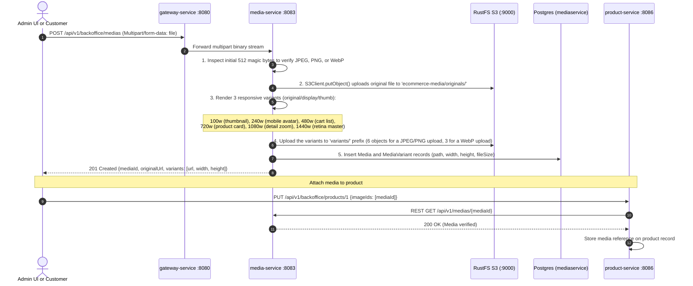

- **Endpoint**: `POST /api/v1/backoffice/medias`
- **Payload**: Multipart form binary file (`image/jpeg`, `image/png`, `image/webp`).
- **Processing Details**:
  - `MediaUploadServiceImpl.upload()`: Reads file magic bytes to verify genuine image formats.
  - Uploads the original file to RustFS S3 via AWS SDK v2 (`PutObjectRequest`).
  - Processes 3 variants: `original` (as uploaded), `display` (width cap `shop.media.display-width`, default 1200px) and `thumb` (width cap `shop.media.thumb-width`, default 320px). Each is stored in the SOURCE format and in WebP, so a JPEG/PNG upload produces 6 objects and a WebP upload produces 3.
  - Generates presigned URLs with 1-hour expiration or returns direct storage paths.
- **Persistence**:
  - RustFS S3 `ecommerce-media`: `originals/<uuid>.<ext>`, `variants/<uuid>_720w.webp`, etc.
  - PostgreSQL `mediaservice`: `medias` and `media_variants` tables.
- **Response**: `201 Created` with media metadata and variant URLs.

---

### Flow 4: Customer Experience: Wishlist, Shopping Cart, and Dynamic Pricing Engine

Covers wishlist bookmarking, cart management, and real-time pricing calculation combining promotional discounts and geographic taxes.

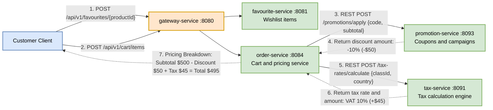

- **Endpoints**:
  - Wishlist toggle: `POST /api/v1/favourites/{productId}`
  - Add to cart: `POST /api/v1/cart/items` `{ productId, quantity: 2, variantId: 10 }`
  - Apply promotional code: `POST /api/v1/cart/apply-coupon` `{ couponCode: "SALE2026" }`
- **Processing Details**:
  - `order-service` (`CartServiceImpl`): Looks up cart by `userId` (or `guestSessionId`), updating `carts` and `cart_items`.
  - `PricingServiceImpl.calculatePricing()`:
    - Calls `promotion-service` (`/api/v1/backoffice/promotions/apply`) to check coupon expiration, usage limits, and minimum order values.
    - Calls `tax-service` (`/api/v1/tax/calculate`) to determine tax rates by shipping destination and product tax category.
    - Computes total: `Total = Subtotal - Discount + Tax + ShippingFee`.
- **Persistence**:
  - PostgreSQL `orderservice`: `carts` and `cart_items` tables.
  - PostgreSQL `favouriteservice`: `favourites` table.
- **Response**: `200 OK` with full cart details and pricing breakdown.

---

### Flow 5: Order Checkout and Two-Phase Stock Reservation Saga (Phase 1)

Prevents overselling during concurrent checkouts through a two-phase stock reservation protocol.

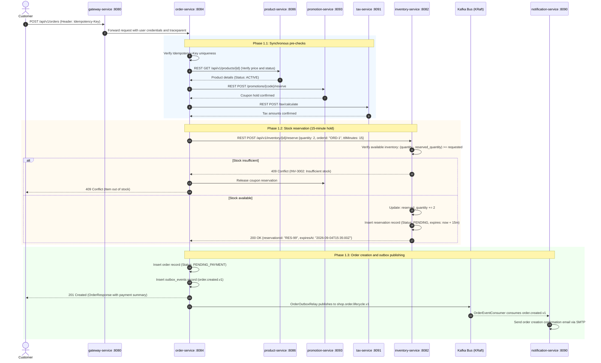

---

### Flow 6: Multi-Gateway Payment Processing and Order Confirmation (Stripe Webhooks and Phase 2 Commit)

Customer completes checkout using Stripe. A verified webhook triggers payment capture, executes the Phase 2 inventory commit, and transitions the order to `CONFIRMED`.

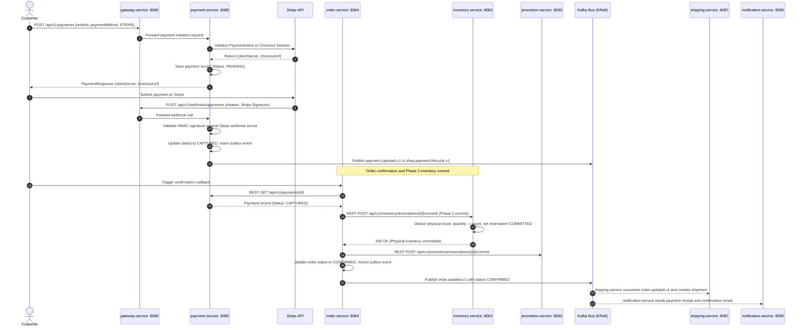

---

### Flow 7: Shipping Logistics, Carrier Integration, and Auto-Delivery

Coordinates fulfillment from order confirmation to final package delivery.

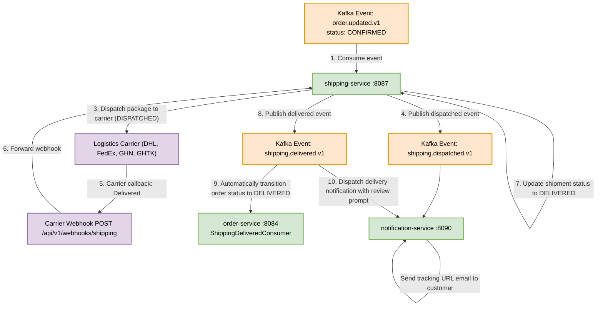

---

### Flow 8: Verified Buyer Rating and Search Ranking Updates (Eligibility Gate RTG-11001)

Restricts review submissions to customers who purchased and received the product, then recalculates product rating metrics.

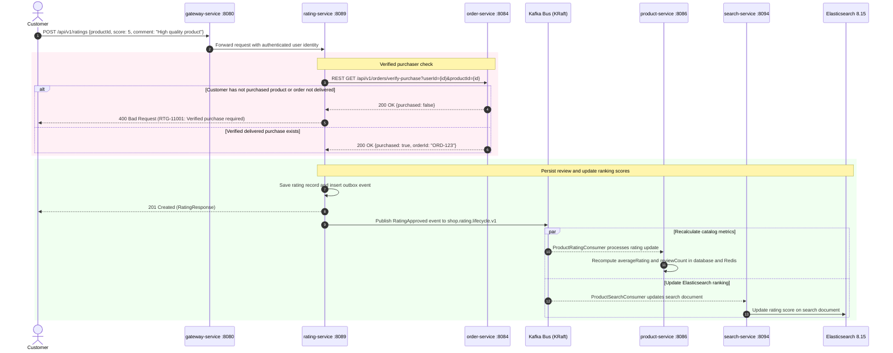

---

### Flow 9: Expired Stock Sweepers, Cancellations, and Saga Compensations

Handles abandoned checkouts, expired reservation holds, and order cancellation compensations.

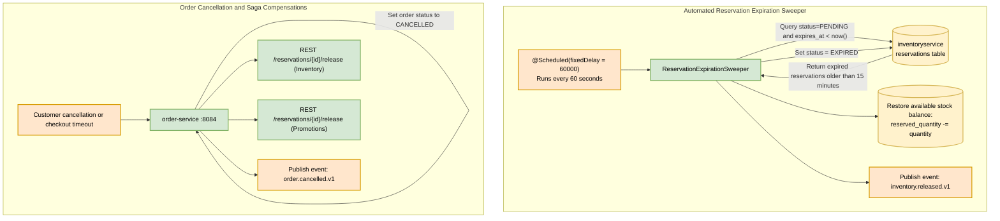

---

### Flow 10: Closed-Loop Return Merchandise Authorization (RMA) Workflow

Covers post-delivery return requests, backoffice inspection approvals, automated payment refunds, and inventory restocking.

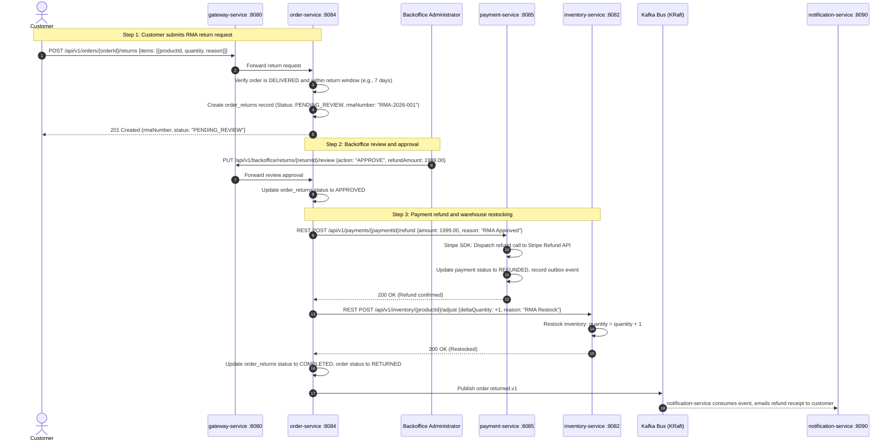

- **Endpoints**:
  - Customer submits request: `POST /api/v1/orders/{orderId}/returns`
  - Admin reviews request: `PUT /api/v1/backoffice/returns/{returnId}/review`
- **Request Body**:
  ```json
  {
    "reason": "Defective charging port",
    "items": [{ "orderItemId": 12, "quantity": 1 }]
  }
  ```
- **Processing Details**:
  - `OrderReturnServiceImpl.createReturn()`: Verifies order status is `DELIVERED`.
  - Assigns unique identifier `RMA-<YEAR>-<UUID>`.
  - When approved: Calls `payment-service` (`/api/v1/payments/{id}/refund`) to process the refund with the payment provider.
  - Calls `inventory-service` to restock returned goods (`quantity += returned_quantity`).
  - Sets `OrderReturn` status to `COMPLETED` and `Order` status to `RETURNED`.
- **Persistence**:
  - PostgreSQL `orderservice`: `order_returns` table, status update in `orders`.
  - PostgreSQL `paymentservice`: `payment_events` table.
  - PostgreSQL `inventoryservice`: updated stock in `inventory`.
- **Response**: `200 OK` with return resolution and refund details.

---

## 4. Event-Driven Messaging Backbone and Kafka Topic Matrix

The messaging infrastructure runs on Apache Kafka 3.9 in KRaft mode. Event producers record changes to an `outbox_events` table in their local database, guaranteeing at-least-once delivery with partition key ordering.

### Kafka Topic Matrix

| Kafka topic | Producer | Partition key | Event types | Consumers and operational actions |
|---|---|---|---|---|
| **`shop.order.lifecycle.v1`** | `order-service` | `orderId` | `order.created.v1`<br/>`order.updated.v1`<br/>`order.cancelled.v1`<br/>`order.returned.v1` | **`shipping-service`**: Consumes `order.updated.v1` (CONFIRMED) to create shipment records.<br/>**`notification-service`**: Dispatches order confirmation, cancellation, and return emails. |
| **`shop.product.lifecycle.v1`** | `product-service` | `productId` | `ProductCreated`<br/>`ProductUpdated`<br/>`ProductDeleted` | **`search-service`**: Upserts or deletes documents in Elasticsearch index `products`. |
| **`shop.inventory.events.v1`** | `inventory-service` | `productId` | `inventory.reserved.v1`<br/>`inventory.committed.v1`<br/>`inventory.released.v1` | **Audit consumers**: Records inventory adjustments. |
| **`shop.payment.lifecycle.v1`** | `payment-service` | `orderId` | `payment.captured.v1`<br/>`payment.failed.v1`<br/>`payment.refunded.v1` | **`order-service`**: `PaymentLifecycleConsumer` auto-confirms order on `payment.captured.v1`.<br/>**`notification-service`**: Dispatches receipts or payment failure notifications. |
| **`shop.shipping.events.v1`** | `shipping-service` | `orderId` | `shipping.dispatched.v1`<br/>`shipping.delivered.v1` | **`order-service`**: Advances order status to `DELIVERED` on delivery confirmation.<br/>**`notification-service`**: Sends tracking information or review invitations. |
| **`shop.rating.events.v1`** | `rating-service` | `productId` | `RatingCreated`<br/>`RatingApproved`<br/>`RatingRejected` | **`product-service`**: Recalculates average ratings and review counts in PostgreSQL and Redis.<br/>**`search-service`**: Updates product search ranking score. |
| **`shop.media.lifecycle.v1`** | `media-service` | `mediaId` | `MediaDeleted` | **`product-service`**: Removes deleted image references from product galleries. |

---

## 5. Database-per-Service Storage and Resilience Architecture

### 1. Database-per-Service Pattern
Cross-database joins are completely avoided:
- Each service connects exclusively to its assigned logical database on PostgreSQL 16 (for example: `jdbc:postgresql://postgres:5432/orderservice`).
- Relationships across service domains use weak reference identifiers (`productId`, `userId`, `orderId`).
- Historical snapshots, such as item price at purchase time, product titles, and shipping addresses, are stored directly in `orders` and `order_items` tables so orders remain immutable if products change later.

### 2. Two-Tier Rate Limiting at the Edge Gateway
- **Tier 1 (Global System Limiter)**: Protects cluster infrastructure against traffic spikes during high-volume promotions. Enforces a cluster-wide ceiling of 2,000 req/s (burst: 4,000 req).
- **Tier 2 (Per-Client Per-Route Limiter)**: Prevents scraping and denial-of-service traffic from individual IPs or accounts. Limits traffic to 100 req/s (burst: 200 req).
- On limit exhaustion, the gateway returns HTTP 429 Too Many Requests immediately.

### 3. Circuit Breaker and Fallback with Resilience4j
- Synchronous HTTP interactions from `order-service` to `product-service`, `tax-service`, `promotion-service`, and `inventory-service` are protected by Resilience4j circuit breakers:
  - `CLOSED`: Requests execute normally.
  - `OPEN`: If the error rate exceeds 50% across a 10-request window, the breaker opens, immediately returning fallback responses.
  - `HALF_OPEN`: After 5 seconds, allows 3 test requests through to evaluate downstream recovery.

### 4. Idempotency and Dead Letter Queues (DLQ)
- Mutating endpoints, such as order creation and payment processing, require client `Idempotency-Key` headers.
- `common-kafka` configures consumers with exponential retry backoff (3 attempts). Persistent poison messages route to dead-letter queue topics (`<topic>.DLT`) for administrative inspection without stalling the main partition.

---

## 6. Archify Interactive Diagram Audit Report

The architecture specification was compiled into standalone interactive visual artifacts:

- **Specification source**: [`petproject-platform.architecture.json`](./petproject-platform.architecture.json)
- **Interactive visualization**: [`petproject-platform.html`](./petproject-platform.html)
- **Publication size**: 777.6 KB (Standalone HTML containing vector SVG graphics, light and dark theme switcher, component filtering, and PNG/SVG export tools).

### Quality Verification Receipt:
```json
{
  "command": "deliver",
  "type": "architecture",
  "specificationSha256": "037284d9afa57b868e8ea110c4546d50a0c663c60b0cd3f22d67b2101f54800d",
  "artifactSha256": "4b31d3ef6981b5f5858f2f2fb188c3442cf0ec69fb3ed36f77e20cfe9deadfbd",
  "validation": {
    "checksPassed": 9,
    "checkCount": 9,
    "compositionProfile": "showcase",
    "compositionStatus": "pass",
    "errors": 0,
    "warnings": 0
  }
}
```

---

## 7. Archify Interactive Showcase Diagrams Directory

Three standalone interactive diagrams provide zoomable, searchable architectural models (9 of 9 validation checks passed, 0 errors, 0 warnings):

| Diagram | Type | Specification JSON | Standalone HTML | Highlights |
|---|:---:|---|---|---|
| **1. System Landscape Architecture** | `architecture` | [petproject-platform.architecture.json](./petproject-platform.architecture.json) | [petproject-platform.html](./petproject-platform.html) | Complete landscape across clients, edge gateway, core domains, datastores, and Kafka |
| **2. E2E Order SAGA & 2-Phase Stock** | `sequence` | [order-fulfillment-saga.sequence.json](./order-fulfillment-saga.sequence.json) | [order-fulfillment-saga.html](./order-fulfillment-saga.html) | Step-by-step saga: pre-checks, 15m stock reservation, Stripe HMAC, parallel commit |
| **3. Transactional Outbox & Event Relay** | `workflow` (v2) | [transactional-outbox.workflow.json](./transactional-outbox.workflow.json) | [transactional-outbox.html](./transactional-outbox.html) | Dual ACID transaction, outbox polling, Kafka dispatch, consumer idempotency and DLQ |

---

<p align="center">
  <b>Petproject Microservices Platform Architecture Blueprint</b><br/>
  Analyzed and documented for Java 25 and Spring Boot 4.1.1
</p>
